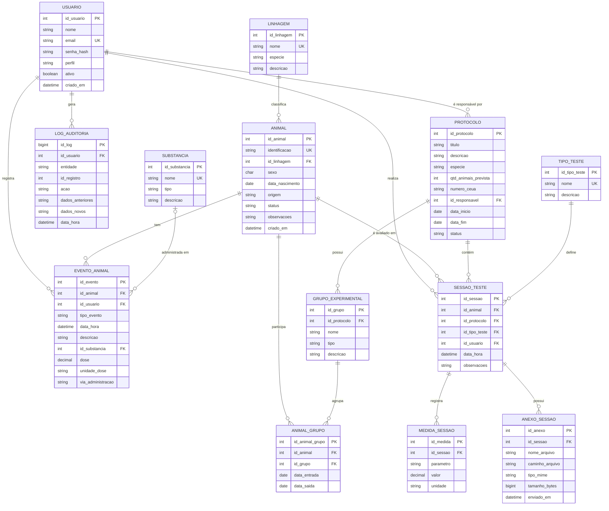

# Clinexus — Modelo Entidade-Relacionamento (MER)

## Decisões de modelagem
- **ANIMAL_GRUPO** resolve a relação N:N entre animais e grupos, guardando data de entrada e saída (histórico).
- **SESSAO_TESTE** liga animal, protocolo e tipo de teste; a regra de que o animal precisa estar em um grupo do protocolo é validada pela aplicação.
- **MEDIDA_SESSAO** guarda cada medida em linha própria, o que permite tipos de teste com parâmetros diferentes sem alterar o esquema.
- **EVENTO_ANIMAL** concentra procedimentos, tratamentos e observações de saúde; `id_substancia`, `dose`, `unidade_dose` e `via_administracao` só se aplicam ao tipo *TRATAMENTO*, no qual são obrigatórios.
- **LOG_AUDITORIA** é genérico (entidade + id do registro), dispensando uma tabela de log por entidade.
- Exclusões físicas são evitadas; usa-se `status`/`ativo` para preservar o histórico da pesquisa.
